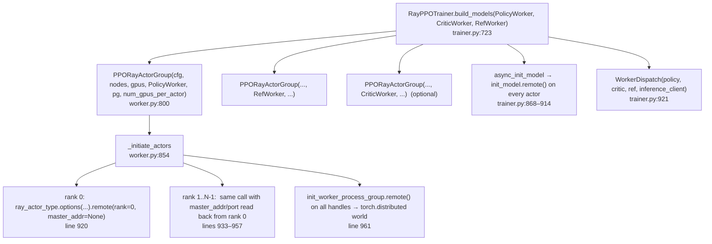

<style>
  #markdown-content table {
    display: block;
    width: 100%;
    max-width: 100%;
    margin: 1.25rem 0;
    overflow-x: auto;
    -webkit-overflow-scrolling: touch;
  }

  #markdown-content td,
  #markdown-content th {
    padding: 0.55rem 0.85rem;
    border-bottom: 1px solid var(--global-divider-color);
    vertical-align: top;
  }
</style>

We use SkyRL for our in-house post-training. Here I collect the learning along this path.

_Source pinned to SkyRL commit `79d4c894` (2026-11-13). Paths are relative to the repo root._

For the training side, there are 3 main components: the `trainer` orchestrates the algorithm, the `dispatch` routes the work to devices, and the `workers` do the GPU algorithms.

## Put a model on n GPUs

We start with a problem that every RL-for-LLM framework has to solve: a training step needs several copies of a model (the one being trained, a frozen reference, maybe a value network, i.e., critic), each sharded across GPUs, each a separate set of processes, all coordinated from one place.

### Three models

| **Role**   | **What it is**                                                                       | **When it exists**                                                         |
| ---------- | ------------------------------------------------------------------------------------ | -------------------------------------------------------------------------- |
| **policy** | The model being trained. Also the weights pushed to vLLM after each step.            | Always                                                                     |
| **ref**    | A frozen copy of the initial policy. Forward only; used to compute KL(policy ‖ ref). | `use_kl_loss or use_kl_in_reward`                                          |
| **critic** | A value network (V(s)) with its own optimizer; feeds GAE.                            | `trainer.critic.model.path` is set; required for `advantage_estimator=gae` |

How exactly the model type needed is dependent on the algorithm: e.g., PPO is policy + critic (+ ref), GRPO is policy + ref, DAPO is policy alone.

### Usage of Ray

Everything below is built on one Ray primitive. Given a class:

```python
PolicyWorker = ray.remote(num_gpus=1)(FSDPPolicyWorkerBase)   # fsdp_worker.py:378
```

1. `ray.remote(cls)` returns an **`ActorClass`**, not the class. `ray.remote(method)` returns a task.
2. `ActorClass.options(num_gpus=0.2, scheduling_strategy=...)` overrides the resource declaration for one instantiation.
3. `ActorClass.remote(*init_args)` starts a **new process** on some node, runs `cls.__init__` there, and returns an **`ActorHandle`**.
4. Every method of `cls` appears on the handle as `handle.method.remote(...)`, which sends an RPC and returns an `ObjectRef`. Direct calls without `.remote` raise `TypeError`.
5. `ray.get(ref)` blocks for the result. Calls to one actor run serially, in submission order.
6. The method lookup is plain attribute access: `getattr(handle, "forward")` is the same as `handle.forward` (`ActorHandle.__getattr__`, `ray/actor.py:2602`). Framework code uses the string form to route many method names through one dispatch path.
7. `ray.put(x)` stores `x` in the shared object store and returns an `ObjectRef`. Passed as a top-level argument to `.remote(...)`, an `ObjectRef` is resolved to the value before the remote method runs, so one serialized copy can feed many actors.

The decorator form `@ray.remote` is the same thing; SkyRL uses the call form so the unwrapped `FSDPPolicyWorkerBase` stays available for subclassing and tests.

### The structure



The place to set up models starts with the method `build_models` in `trainer.py`.

Two levels here:

- **Outer**: `build_models` calls `PPORayActorGroup(...)` once per role. Between calls, the only thing that changes is which `ActorClass` is passed, i.e., `PolicyWorker`, `RefWorker` or `CriticWorker`.
- **Inner**: each `PPORayActorGroup` runs `_initiate_actors` once, creating `world_size` actors of that one class: rank 0 first (it picks a free port), then ranks 1..N-1 with rank 0's address, then one `init_worker_process_group` across all of them.

**Inside `init_worker_process_group`.** Before calling this method, the N actors are N separate Python processes that know their own `rank` and the master address, but cannot talk to each other yet. Line 961 in `worker.py` (`ray.get([actor.init_worker_process_group.remote() for actor in self._actor_handlers])`) turns them into one `torch.distributed` world.

Inside each actor (`DistributedTorchRayActor.init_worker_process_group`, `worker.py:169`) three things happen:

1. **Join the process group.** `torch.distributed.init_process_group(backend="cpu:gloo,cuda:nccl")` uses the default `env://` rendezvous, reading `MASTER_ADDR`, `MASTER_PORT`, `WORLD_SIZE` and `RANK`, which the actor's `__init__` exported (`worker.py:146–153`). That is why rank 0 had to be created first and its address read back: every rank must point at the same master. NCCL carries GPU tensors, gloo carries CPU tensors.
2. **Build a `(dp, sp)` device mesh** of shape `(world_size // sequence_parallel_size, sequence_parallel_size)`. With 4 GPUs and no sequence parallelism that is `[[0],[1],[2],[3]]`; with `sequence_parallel_size=2` it is `[[0,1],[2,3]]`. The mesh creates one subgroup per dimension: the `sp` group feeds Ulysses sequence parallelism, the `dp` group is used for cross-replica reductions.
3. **Record `MeshRank(dp, sp, tp=0, pp=0, dp_size, ...)`**, the actor's coordinates in that mesh. Line 963 reads it back with `get_mesh_rank.remote()` into `actor_infos`, which is what `MeshDispatch` later uses to decide which data chunk each actor gets.

For Megatron the same method runs, but `init_model` later recomputes `MeshRank` from megatron-core's `parallel_state` (`megatron_worker.py:1140`), which is when `tp` and `pp` get real values.

A 4-GPU GRPO run with KL therefore has 8 training processes: four `PolicyWorker` and four `RefWorker`, in two independent `torch.distributed` worlds of size 4.

### The generic actor

```python
master_actor = self.ray_actor_type.options(**actor_options).remote(
    cfg=self.cfg,
    world_size=world_size,
    rank=0,
    local_rank=0,
    master_addr=None,
    master_port=None,
    sequence_parallel_size=self.sequence_parallel_size,
    record_memory=self.record_memory,
)
```

The class `PPORayActorGroup` does not specify what it is building, a policy or a ref, FSDP or Megatron.

The key variable and parameters are:

**1. `self.ray_actor_type`.** Example values can be `ray.remote(num_gpus=1)(FSDPPolicyWorkerBase)` or `(MegatronPolicyWorkerBase)`. The call chain that delivers it:

| **Stop** | **Location**           | **Code**                                                                                           | **Name here**                               |
| -------- | ---------------------- | -------------------------------------------------------------------------------------------------- | ------------------------------------------- |
| 1        | `main_base.py:262–273` | `if strategy == "fsdp": from ...fsdp_worker import PolicyWorker, ...`                              | `PolicyWorker`, a local in `_setup_trainer` |
| 2        | `main_base.py:352`     | `trainer.build_models(PolicyWorker, CriticWorker, RefWorker)`                                      | passed positionally                         |
| 3        | `trainer.py:723`       | `def build_models(self, PolicyWorker, CriticWorker, RefWorker)`                                    | `PolicyWorker`, a parameter                 |
| 4        | `trainer.py:748–752`   | `PPORayActorGroup(cfg.trainer, nodes, gpus, PolicyWorker, pg=..., ...)`                            | 4th positional argument                     |
| 5        | `worker.py:821, 838`   | `def __init__(..., ray_actor_type: Type[Worker], ...)` then `self.ray_actor_type = ray_actor_type` | **renamed** to `ray_actor_type`             |

**FSDP vs Megatron is decided only at stop 1**, by which module gets imported.

**2. `actor_options`.** `build_models` passes `pg` and `num_gpus_per_actor`; `_initiate_actors` turns them into a `PlacementGroupSchedulingStrategy` per rank. For example: `num_gpus=0.2` + shared PG (colocated) or `num_gpus=1` + own PG.

### One example

**`examples/train/gsm8k/run_gsm8k.sh`**

In this script, `colocate_all=true` (inference and training share all the GPUs), 4 GPUs, `use_kl_loss=true`.

On the first call (policy), the rank-0 call at `worker.py:921` (`master_actor = self.ray_actor_type.options(**actor_options).remote…`) is effectively:

```python
PolicyWorker.options(
    num_cpus=0.2, num_gpus=0.2,
    scheduling_strategy=PlacementGroupSchedulingStrategy(colocate_pg, bundle_index=0),
).remote(cfg=cfg.trainer, world_size=4, rank=0, local_rank=0,
         master_addr=None, master_port=None, sequence_parallel_size=1, record_memory=False)
```

`build_models` has one `if`: `trainer.placement.colocate_all` decides whether training shares the GPUs with inference (colocated) or gets its own.

### Dispatch in `build_models` and the following training loop

`trainer.py` and `fsdp_worker.py` never import each other. The controller holds actor handles and method names; which class answers is decided by what was injected into `PPORayActorGroup`.

The code snippet in `build_models` we study now is

```python
self.policy_model: PPORayActorGroup = policy_model
self.critic_model: Optional[PPORayActorGroup] = critic_model
self.ref_model: Optional[PPORayActorGroup] = ref_model

# Create unified dispatch that manages all actor groups
self.dispatch = WorkerDispatch(
    cfg=self.cfg,
    policy_actor_group=policy_model,
    critic_actor_group=critic_model,
    ref_actor_group=ref_model,
    inference_engine_client=self.inference_engine_client,
)
```

|                                                                                        | **What it is**              | **Job**                                                                                                                                                                                                   |
| -------------------------------------------------------------------------------------- | --------------------------- | --------------------------------------------------------------------------------------------------------------------------------------------------------------------------------------------------------- |
| `WorkerDispatch` (`worker_dispatch.py:45`)                                             | Facade the trainer talks to | Finds the actor group by role name, tracks whether each group is on GPU or CPU and backloads/offloads as needed, runs the weight-sync bracket, and delegates the actual fan-out to a dispatch type below. |
| `MeshDispatch`, `PassThroughDispatch` (two types of dispatch in `dispatch.py:87, 214`) | Fan-out strategy            | Decide how one call becomes N actor calls: `mesh` splits the batch by DP (data parallelism) rank, `pass_through` sends identical arguments to every actor (`init_model`, weight sync).                    |

The motivation of dispatch is separation of concerns: the trainer decides _what_ the algorithm does this step; `WorkerDispatch` decides _how_ the GPU workers get it done.

#### `train()` and dispatch

Every dispatch call into the GPU workers comes from `train()` (`trainer.py:311`). Before the training loop, there are some setups with dispatch involved.

**1. `init_weight_sync_state`.** `self.init_weight_sync_state()` in `trainer.py:320` → `self.dispatch.init_weight_sync_state(self.inference_engine_client)`, which calls `WorkerDispatch.init_weight_sync_state`, defined as

```python
def init_weight_sync_state(self, inference_engine_client) -> None:
    """Initialize weight sync state for policy model."""
    deadline.ray_get(
        self._actor_groups["policy"].async_run_ray_method(  # only policy
            "pass_through",
            "init_weight_sync_state",
            inference_engine_client,
            self.cfg.generator.inference_engine,
        ),
        "init_weight_sync_state",
    )
```

Here `self._actor_groups["policy"]` is the policy `PPORayActorGroup` (`_actor_groups` is a dict keyed by role), which has `async_run_ray_method` as a method:

```python
def async_run_ray_method(self, dispatch_type: str, method_name: str, *args: Any, **kwargs: Any) -> List[ObjectRef]:
    """Run a method on all actors using specified dispatch type asynchronously.

    Args:
        dispatch_type: Type of dispatch to use ("mesh" or "pass_through")
        method_name: Name of the method to call on actors
        *args: Positional arguments to pass to the method
        **kwargs: Keyword arguments to pass to the method

    Returns:
        List of object references
    """
    dispatch_class: Dispatch = DispatchRegistry.get(dispatch_type)
    # validate the dispatch args to be sent to `.dispatch`
    args, kwargs = dispatch_class.validate_dispatch_args(*args, **kwargs)

    # Dispatch the method call
    object_refs = dispatch_class.dispatch(self.actor_infos, method_name, *args, **kwargs)
    return object_refs
```

Here `self.actor_infos` is a list of `ActorInfo(handle, rank)`, one per actor: `[ActorInfo(actor, ray.get(actor.get_mesh_rank.remote())) for actor in self._actor_handlers]`. In this case, `dispatch_class` is `PassThroughDispatch`, and the call essentially runs `PassThroughDispatch.dispatch(self.actor_infos, method_name, ...)`, which is defined as

```python
@classmethod
def dispatch(cls, actor_infos: List[ActorInfo], method: str, *args, **kwargs) -> List[ObjectRef]:
    return [getattr(actor_info.handle, method).remote(*args, **kwargs) for actor_info in actor_infos]
```

`actor_info.handle` is an `ActorHandle` to one of the processes created from `ray_actor_type` (= `PolicyWorker`, the Ray-wrapped `FSDPPolicyWorkerBase`) in `_initiate_actors`, and `PolicyWorker = ray.remote(num_gpus=1)(FSDPPolicyWorkerBase)` (`fsdp_worker.py:378`). Then the above classmethod tries to find the method `init_weight_sync_state` in `FSDPPolicyWorkerBase` (and its parents eventually):

```python
async def init_weight_sync_state(
    self,
    inference_engine_client: "RemoteInferenceClient",
    inference_engine_cfg: "InferenceEngineConfig",
):
    """Build this rank's weight source and rendezvous its trainer engine.

    After this, ``broadcast_to_inference_engines`` is one
    ``engine.send_weights()`` call per sync — the engine owns the whole round
    trip (start / update / finish, the barriers, and the non-sender
    collective replay).

    .. note::
        This function must be called on all the ranks in the worker group
        simultaneously: rank 0 blocks driving the inference-side handshake
        while the others reach the collectives it needs.
    """
    from skyrl.backends.skyrl_train.weight_sync.weight_senders import (
        build_trainer_engine,
    )

    assert inference_engine_client is not None
    # Cache the client so per-sync broadcast_to_inference_engines calls can
    # pass None instead of re-shipping it: the client carries the HF
    # tokenizer (~10MB, 0.13s pickle + 0.34s unpickle), which otherwise
    # rides every sync's RPC fan-out. Workers only use its static parts
    # (server URLs, cfg flags); the driver's live copy owns weight_version.
    self._weight_sync_inference_client = inference_engine_client

    # Fetch the total inference world size from the servers.
    inference_world_size, _ = await inference_engine_client.get_world_size()

    # Off the event loop, on every rank: rank 0 drives the inference-side
    # handshake with blocking HTTP while the others return immediately.
    #
    # Rendezvous happens HERE, not on the first send. sharded_rdt requires
    # that: deferring it deadlocks, because rank 0 would block in the
    # inference-side init RPC while the other ranks spin in gather
    # collectives, and the producer sidecars -- sharing those ranks' GPUs --
    # could then never finish NIXL agent creation, since libfabric's CUDA
    # probe blocks behind the spinning kernels. Every rank is inside this
    # method here, so that window is empty.
    self._weight_sync_engine = await self._weight_sync_thread(
        build_trainer_engine,
        ie_cfg=inference_engine_cfg,
        colocate_all=self.cfg.placement.colocate_all,
        rank=torch.distributed.get_rank(),
        inference_world_size=inference_world_size,
        source_factory=self._build_weight_source,
        draft_source_factory=self._build_draft_weight_source,
        server_urls=list(inference_engine_client.server_urls),
        data_parallel_size=int(inference_engine_client.data_parallel_size),
        base_model_path=self.cfg.policy.model.path,
    )

    torch.distributed.barrier()
```

**2. `load_checkpoints`.** `self.load_checkpoints()` in `trainer.py:325` does the same thing: `RayPPOTrainer.load_checkpoints` calls

```python
self.dispatch.load_checkpoint(
    "policy",
    policy_ckpt_dir,
    load_optimizer_states=True,
    load_lr_scheduler_states=True,
)
```

→ `WorkerDispatch.load_checkpoint`. As in the item above, `self._actor_groups["policy"]` is the policy `PPORayActorGroup`, and the call eventually runs the method `load_checkpoint` of `FSDPPolicyWorkerBase` (`PolicyWorkerBase`, `Worker`).

The numbered steps are the comments in the loop body of `train()`.

| **Step**                | **Where**                                                                  | **Dispatch call**                                                                    | **Fan-out**                            | **Runs when**                                                                 |
| ----------------------- | -------------------------------------------------------------------------- | ------------------------------------------------------------------------------------ | -------------------------------------- | ----------------------------------------------------------------------------- |
| 1.1 generate            | `trainer.py:401`                                                           | none: the generator talks to vLLM over HTTP                                          | —                                      | always                                                                        |
| after 1.1               | `trainer.py:421`                                                           | `inference_engine_client.sleep()`, not the dispatch                                  | —                                      | colocated only                                                                |
| 4 old logprobs / values | `fwd_logprobs_values_reward` → `_execute_forward_pass` (`trainer.py:1387`) | `dispatch.forward("critic" / "ref" / "policy", batch)`                               | `mesh`                                 | critic: if it exists. ref: if KL is on. policy: unless `_skip_policy_forward` |
| 4, variant              | `trainer.py:1380–1383`                                                     | `stage_data` + `forward_from_staged`                                                 | `mesh`, pre-staged                     | instead of the above when `recompute_old_logprobs_per_minibatch=true`         |
| 7 train                 | `_execute_training_step` (`trainer.py:1651–1661`)                          | `stage_data` once, then per mini-batch `forward_backward_from_staged` + `optim_step` | `mesh` pre-staged, then `pass_through` | critic first if it exists, then policy                                        |
| 8 checkpoint            | `save_checkpoints` (`trainer.py:1784`)                                     | `dispatch.save_checkpoint(...)`                                                      | `pass_through`                         | every `ckpt_interval` steps                                                   |
| 10 sync                 | `trainer.py:539`                                                           | `dispatch.save_weights_for_sampler()`                                                | `pass_through`                         | always                                                                        |

For example, similar to items 1 and 2 above, in step 4 of the training loop:

```python
# 4. Inference and calculate values, log probs, rewards, kl divergence
with Timer("fwd_logprobs_values_reward", self.all_timings):
    training_input = self.fwd_logprobs_values_reward(training_input)
```

which calls the method `_execute_forward_pass` and then `output = self.dispatch.forward(model, data_fwd_pass)`. In this case, the `forward` method is defined in class `WorkerDispatch` as

```python
def forward(
    self,
    model: str,
    data: TrainingInputBatch,
    loss_fn: Optional[str] = None,
    loss_fn_config: Optional[Dict[str, Any]] = None,
    model_id: Optional[str] = None,
    **worker_kwargs,
) -> WorkerOutput:
    """Run forward pass. Only loads model (not optimizer).

    Returns a :class:`WorkerOutput` aggregated across DP ranks:

    - When ``loss_fn`` is None (RL/inference path): ``loss_fn_outputs`` is a
      per-sample list of dicts (one entry per batch item) keyed by
      ``logprobs`` (policy/ref) or ``values`` (critic); ``metrics`` is empty.
    - When ``loss_fn`` is set (e.g., ``"cross_entropy"``): ``loss_fn_outputs``
      carries per-sample arrays (e.g. ``logprobs`` / ``elementwise_loss``)
      and ``metrics`` contains scalar metrics like ``"loss"``.
    """
    self._ensure_on_gpu(model, need_optimizer=False, need_model=True)
    self.ensure_active_adapter(model, model_id)

    kwargs = dict(worker_kwargs)
    if loss_fn is not None:
        kwargs["loss_fn"] = loss_fn
    if loss_fn_config is not None:
        kwargs["loss_fn_config"] = loss_fn_config

    refs = self._actor_groups[model].async_run_ray_method("mesh", "forward", data=data, **kwargs)
    results = deadline.ray_get(refs, "forward")

    return WorkerOutput.cat(self._actor_groups[model].actor_infos, results)
```

This function makes sure the compute is on GPU, and calls `self._actor_groups[model].async_run_ray_method("mesh", "forward", ...)`. Same as before, this corresponds to the dispatch method of `MeshDispatch` and the execution of the `forward` method of `PolicyWorkerBase`:

```python
def forward(
    self,
    data: TrainingInputBatch,
    loss_fn: Optional[str] = None,
    loss_fn_config: Optional[Dict[str, Any]] = None,
    return_per_token_outputs: bool = True,
) -> WorkerOutput:
    """Run forward pass.

    - When ``loss_fn`` is None: runs inference in micro batches of
      ``micro_forward_batch_size_per_gpu`` and returns a :class:`WorkerOutput`
      with per-sample ``loss_fn_outputs`` (``logprobs`` key) and empty
      ``metrics``.
    - When ``loss_fn`` is set (e.g., ``"cross_entropy"``): runs the loss in ``no_grad`` mode
      (no backward), iterating over micro-batches of ``micro_forward_batch_size_per_gpu``,
      and returns a :class:`WorkerOutput` with per-sample ``loss_fn_outputs`` plus
      ``metrics`` (e.g. ``"loss"``).  Metrics are all-reduced across the DP group
      to mirror :meth:`forward_backward`.
    """
    if loss_fn is None:
        # Inference forward path: run in micro batches and emit per-sample logprobs.
        microbatch_iterator = get_microbatch_iterator(
            data,
            micro_batch_size=self.cfg.micro_forward_batch_size_per_gpu,
            max_tokens_per_microbatch=self.cfg.max_tokens_per_microbatch,
        )
        outputs = [self._forward_micro_batch(micro_batch) for micro_batch in microbatch_iterator]
        output = microbatch_iterator.reorder_and_combine_batches(outputs)
        if output.device is not None and output.device != torch.device("cpu"):
            output = output.to("cpu")
        row_tensor = output["output"]
        loss_fn_outputs = [{"logprobs": row_tensor[i].tolist()} for i in range(row_tensor.shape[0])]
        return WorkerOutput(loss_fn_outputs=loss_fn_outputs, metrics={})

    micro_batch_size = self.cfg.micro_forward_batch_size_per_gpu
    all_metrics = defaultdict(list)
    all_loss_fn_outputs: List[Dict[str, Any]] = []

    for micro_batch in BatchIterator(data, micro_batch_size, drop_last=False):
        metrics = self._forward_micro_with_loss(
            micro_batch,
            loss_fn=loss_fn,
            loss_fn_config=loss_fn_config,
            return_per_token_outputs=return_per_token_outputs,
        )
        if "loss_fn_outputs" in metrics:
            all_loss_fn_outputs.extend(metrics.pop("loss_fn_outputs"))
        for k, v in metrics.items():
            all_metrics[k].append(v)

    result = reduce_metrics(all_metrics, sum_loss_metrics=True)
    dp_group = self.device_mesh.get_group("dp")
    result = all_reduce_metrics(result, self.strategy, group=dp_group, sum_loss_metrics=True)

    return WorkerOutput(loss_fn_outputs=all_loss_fn_outputs, metrics=result)
```
